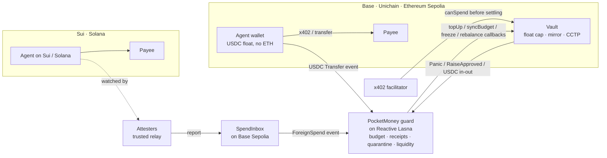

# Pocket Money

**A cross-chain allowance for AI agents. Worst case, you lose the float.**

Built for the [Reactive Omni Buildathon](https://dorahacks.io/hackathon/reactive-omni-buildathon) · track *Set It and Forget It* · testnet.

You give an AI agent a wallet and it pays for things on its own, often over [x402](https://x402.org), on whichever chain is cheapest. Pocket Money gives that agent **one daily allowance that holds across every chain at once**, refuses payments that would go over it **before they settle**, and freezes the agent everywhere the moment it pays someone you didn't approve, including on chains Reactive can't watch.

Everything here runs on testnets, and every claim below links to a transaction in [`deployments/EVIDENCE.md`](deployments/EVIDENCE.md).

---

## In 30 seconds

**The setup:**
- **Small floats only.** On each chain the agent holds a small **float** of USDC (say $1), and no ETH at all. x402 payments are gasless for the payer, so the only thing the agent's key can move is that float.
- **Watching every payment.** A **guard** contract on Reactive Network watches the agent's USDC transfers on Base, Unichain and Ethereum Sepolia. It books every payment against **one shared daily budget** and chains it into a receipt hash.
- **Topping up.** After each approved payment, the guard asks that chain's **vault** to refill the float. Top-ups stop when the budget is gone.

**Every vault also keeps a budget mirror.** It's a copy of the agent's remaining *cross-chain* budget, pushed by the guard after every payment. An x402 facilitator calls `canSpend(agent, amount)` and refuses an over-budget payment before settling it. Our own x402 seller does exactly that.

**What happens when something goes wrong:**
- **An unapproved payee freezes the agent everywhere.** One payment to an address you didn't approve freezes that agent on **every** chain. That includes payments on **Sui and Solana**: a relay reports them to an inbox on Base, so they count against the same budget.
- **Panic on any chain.** Pressing panic on any one chain freezes every vault.
- **A raise from any chain.** Approving a one-day raise on any chain re-syncs every mirror within seconds.

**Vault liquidity is managed too.** When a vault runs low, the guard has the fullest sibling vault send USDC over Circle CCTP.

## Why this needs Reactive

**No single chain can see an agent's spending on the others.** A smart-account allowance on Base knows nothing about what the same agent spent on Unichain five seconds ago.

Pocket Money's budget, receipt chain, quarantine and liquidity view live in one Reactive contract, which hears every chain's events and answers with callbacks. **Take Reactive away and there's no cross-chain budget left to enforce.**

**Why Omni's ~1 s blocks matter here:**
- **The float has to cover the delay.** It has to cover whatever the agent can spend while a top-up is still in flight: `float ≥ spend rate × top-up delay`.
- **The delay shrinks with block time.** We measured spend → top-up live: 8–11 Base blocks (~1.6–2.2 s), 2 Unichain blocks (~2 s), and the next block on Ethereum Sepolia.
- **That means less money at risk.** On the previous Reactive (~7 s blocks), the Reactive leg alone would add seconds to every top-up. Shorter blocks let the float be smaller.

## How it fits together



| Contract | Where | Job |
|---|---|---|
| [`PocketMoney`](src/PocketMoney.sol) | Reactive Lasna | Books every payment on every chain, keeps the household's allowances and ceiling, chains receipts, quarantines, panics, grants raises, tracks vault balances and requests CCTP refills |
| [`Vault`](src/Vault.sol) | each EVM chain | Holds the owner's USDC. Tops up floats (capped locally at the agent's float), mirrors the budget (`canSpend`), freezes, and sends CCTP refills only to owner-approved peers under a cap |
| [`SpendInbox`](src/SpendInbox.sol) | Base Sepolia | Where the Sui and Solana attesters report payments, each one exactly once |
| [`SpendLimitRegistry`](src/SpendLimitRegistry.sol) | each EVM chain | Maps an agent to its vault so **any** x402 seller can find the limit. The agent is bound once, by its own signature; after that only the owner can change the entry |

**Off-chain pieces** (no special powers, all in [`agent/`](agent/src)):
- **The x402 seller and the agent's daily job**
- **The CCTP relayer:** anyone may relay.
- **The Sui and Solana attesters**
- **The receipt verifier**

## The loops, live

Every row is on-chain. The tx hashes are in [`deployments/EVIDENCE.md`](deployments/EVIDENCE.md).

| Loop | What happened |
|---|---|
| Spend → top-up | The agent paid over x402 on each of the three chains; each float was refilled (Base, Unichain, Ethereum Sepolia) |
| Refuse before settling | The budget was used up, so the seller refused with `pocket_money_over_budget` on a chain the agent hadn't touched that day. **Nothing moved.** |
| Any seller can enforce it | Two sellers with separate keys were given only each chain's registry address, no vault address. The agent bought from both across all three chains; the fourth purchase was refused by the second seller before settling |
| Ask for a raise | The owner approved +$0.30 **on Ethereum Sepolia**; the agent's retry **on Unichain** settled |
| Unknown payee → frozen everywhere | A stray payment on Unichain, on Sui, and on Solana each froze the agent on all three EVM chains |
| Panic | Panic on Ethereum Sepolia froze all three vaults |
| CCTP refill | The Base vault dropped below its floor; the guard had Ethereum Sepolia's vault burn 1.10 USDC; Circle attested in 20 s; the relayer minted on Base |
| Fail safe | An Ethereum Sepolia top-up ran out of gas (that chain's proxy overhead is 150k). Nothing was sent and nothing was corrupted. Fixed with a per-chain callback gas limit |

## Safety: what we prove, and how

See [`SECURITY.md`](SECURITY.md) for the threat model, the trust assumptions, and the full static-analysis triage.

**Unit tests:**
- 42 Foundry unit tests run against a Reactive Network simulator. It matches every emitted log against the guard's real subscriptions, feeds it to `react()`, and delivers the requested callbacks (or delivers each one twice, to prove every callback is safe to repeat).
- The heaviest `react()` uses 193k gas (cap: 900k).
- 21 more cover the [`SpendLimitRegistry`](src/SpendLimitRegistry.sol): only a payer's own signature can bind it, a stolen payer key can't rebind, move or lift its entry, and a facilitator that resolves the mirror through the registry refuses spending done on other chains.

**Invariant fuzzing (8 properties):**
- **What gets fuzzed:** random payments to the shop or a thief, on any chain or on Sui, plus panics, allowance changes, raises, midnight rollovers and CCTP refills.
- **The properties:**
  - no agent ever holds more than its float
  - top-ups stay within the allowance and the ceiling
  - a stolen key's take is bounded by the floats
  - freezes reach every chain
  - the mirror matches the guard
  - the guard's view of vault balances matches the chain
  - USDC is conserved
  - every payment has exactly one receipt
- **Scale:** the deep run used 30,720 random actions per property.
- **It found two real bugs:**
  - one agent's after-midnight spending missing from other agents' mirrors
  - a raise outliving its day

  Both are fixed and kept as regression tests that fail on the old code.

**Static analysis:** Slither, with every finding fixed or explained.

## Check it yourself in 2 minutes

You need [Foundry](https://getfoundry.sh) and Node 20+. No keys.

**Rebuild the receipt chain from the chains where the money actually moved:**
- **EVM payments** are matched to the USDC Transfer in the origin transaction.
- **Sui and Solana payments** are matched to the inbox's record.
- The rebuilt chain is compared with the guard's own receipt head.

```bash
cd agent && npm ci && cd .. && script/verify.sh
```

Tamper test (it must say FAILED):

```bash
TAMPER=1 script/verify.sh
```

Read the mirror on any chain (here, Unichain Sepolia):

```bash
cast call 0x9408E947d6654417BAcF45548070A0453690AdA3 "canSpend(address,uint256)(bool,uint256,bytes32)" 0x7Cd681561d75805156568ccF6D8f1Cf0536da06b 100000 --rpc-url https://sepolia.unichain.org
```

**The dashboard** ([`dashboard/`](dashboard)) is a static page that reads the same chains directly:

```bash
python3 -m http.server 4173 --directory dashboard
```

Its second page, [`how.html`](dashboard/how.html), follows one real payment through all five steps, and lets you ask the live vaults whether an amount of your choosing would be allowed.

## Current deployment (testnet)

| | Address |
|---|---|
| Guard · Reactive Lasna | `0x5Bc6C4F0dC05B47413AD86EE39C632E408677A5A` |
| Vault · Base Sepolia | `0x4eE05aab7Afd0EAF7098620cC9FaaA3c27fB98B5` |
| Vault · Unichain Sepolia | `0x9408E947d6654417BAcF45548070A0453690AdA3` |
| Vault · Ethereum Sepolia | `0xfEf8522B931Ded31aeAe2F8FF5cb6B5e60E1289d` |
| SpendInbox · Base Sepolia | `0xD7c7732520FCb454673aB42229Eb60356E96A8A8` |
| Registry · Base Sepolia | `0xD48A658E4862682FA47C57464E52Cfa3b376E3e1` |
| Registry · Unichain Sepolia | `0x77BE935e39274963E18E32567e980387aAAae6b8` |
| Registry · Ethereum Sepolia | `0x51954B6F45739d549644B292DC42b9f63BdFd312` |

Earlier versions were retired on-chain with the vaults' logged `migrate()`, so their history stays visible.

## Run your own

On testnet, for your own agent. Your keys stay in Foundry keystores on your machine and the contracts are yours; nothing in this repo holds your funds.

```bash
git clone --recurse-submodules https://github.com/DrVelvetFog/pocket-money && cd pocket-money
./quickstart
```

You need Foundry, Node 20+ and `jq`. `./quickstart` then:

1. creates three testnet keystores: `pm-owner` (sets the limits), `pm-agent` (the agent's spending key) and `pm-seller` (a demo shop to buy from)
2. waits while you use two faucets: Ethereum Sepolia ETH and Circle test USDC. It buys lREACT and bridges Base Sepolia gas for you
3. deploys your guard on Reactive, a vault on Base Sepolia and Ethereum Sepolia, and a registry on each
4. has the agent make one real x402 purchase per chain and prints the origin, Reactive and top-up transaction for each

It can be stopped and run again; it picks up where it left off. `./quickstart --plan` shows what is done and what is missing, and sends nothing. For all three chains: `CHAINS="84532 1301 11155111" ./quickstart` (you fund Unichain Sepolia gas yourself).

The repository ships the author's deployment as a worked example. `./quickstart` asks before setting it aside for yours.

## Using it

| You want to | Do this |
|---|---|
| See the passbook | `cd dashboard && python3 -m http.server 4173`, then open `http://localhost:4173` |
| Check everything is healthy | `./quickstart check` (read-only; each problem comes with its fix) |
| Be told when something needs you | `script/watch.sh` (frozen or quarantined agent, panic, guard low on lREACT, vault low on USDC or gas). Set `ALERT_URL` to an [ntfy](https://ntfy.sh) topic to get it on your phone |
| Change the daily allowance | `cast send $PM "setAgent(address,uint256)" $AGENT <units> --account pm-owner --rpc-url https://lasna-rpc.rnk.dev/` (6 decimals: `3000000` is $3) |
| Approve someone the agent may pay | `cast send $PM "setPayee(address,bool)" <address> true ...` Paying anyone else freezes the agent everywhere |
| Give the agent a one-day raise | `cast send <any vault> "approveRaise(address,uint256)" $AGENT <units> ...` on whichever chain is handy |
| Stop everything | `cast send <any vault> "panic()" --account pm-owner --rpc-url <that chain>` |
| Recover after a freeze | `script/drill.sh` shows each case and its reset |
| Replace a leaked seller key | `script/rotate-seller.sh` |
| Run the agent's job every morning, unattended | `script/keychain-setup.sh`, then `script/go-live.sh`. macOS keeps the two job passwords in your Keychain and schedules with launchd. Linux keeps them in `~/.config/pocket-money/` (readable only by you, which is weaker) and schedules with cron. With less than 3 lREACT in the guard: `MIN_LREACT=1 script/go-live.sh` |

`$PM`, `$AGENT` and the vault addresses are in `deployments/testnet.env` and `deployments/wallets.env`.

**Your own agent instead of the demo one:** any x402 client works. Give it the `pm-agent` key and nothing else. It needs no ETH: it signs, and the seller settles. See [`agent/src/agent.ts`](agent/src/agent.ts) (40 lines).

**Step by step, by hand:**
- `script/deploy.sh` deploys the guard, the vaults and the inbox, and wires everything up.
- `script/setup-seller.sh` funds the seller and approves it as a payee.
- `script/deploy-registry.sh` deploys a registry on each chain and binds the agent to its vault.
- Demos: `script/x402-demo.sh`, `script/v4-demo.sh`, `script/registry-demo.sh`, `script/raise-demo.sh`, `script/sui-demo.sh`, `script/solana-demo.sh`, `script/drill.sh stray|stolen|panic|dry`

**Testing:**

```bash
forge test
```

Deep fuzzing:

```bash
FOUNDRY_INVARIANT_RUNS=512 FOUNDRY_INVARIANT_DEPTH=60 forge test --mc PocketMoneyInvariants
```

## Why not just a per-chain cap?

**A per-chain cap is a fence around one field.** An agent with a $3 cap on each of three chains has a $9 budget, and no chain can tell when the agent has already spent its $3 elsewhere. Pocket Money keeps **one** budget across every chain (and Sui and Solana), and still keeps a hard local cap on each chain: the float.

**The two layers are independent:**
- **If the guard is wrong,** a vault still never fills the agent past its float.
- **If an agent key is stolen,** the floats are all it can take.

## Limits, stated plainly

- **Root of trust:** the owner key sets limits and payees, and can migrate funds. Keep it on a different device from any agent.
- **Sui and Solana run through a trusted relay.** A false report can only tighten the budget or freeze the agent; silence is bounded by the floats. Sui and Solana have no vault, so payments there are counted and policed but not topped up.
- **Mirror lag:** a vault's mirror updates about one block (of its own chain) after the guard books a payment. That's ~12 s on Ethereum Sepolia. The float bounds that window.
- **Reorgs:** Reactive's docs don't say whether it waits for origin-chain confirmations. A reorged payment could already have been topped up; the float bounds it.
- **Only USDC is guarded.** Other tokens are out of scope.
- **Testnet only.** Not audited.

## Also in this repo

- [`docs/x402-spend-limit-extension.md`](docs/x402-spend-limit-extension.md): a **draft** x402 extension so any facilitator can check a payer's owner-controlled spend limit before settling. Not submitted.
- [`SECURITY.md`](SECURITY.md): threat model, invariants, and static-analysis triage.
- [`deployments/EVIDENCE.md`](deployments/EVIDENCE.md): every live claim, with transaction hashes, including the failures.

## Built during the event

All of Pocket Money's code was written during the buildathon. Prior work enters only as dependencies:
- [`reactive-lib-omni`](https://github.com/Reactive-Network/reactive-lib-omni)
- Coinbase's [`@x402/*`](https://github.com/x402-foundation/x402) packages
- `viem`
- `@mysten/sui`
- `@solana/kit`
- Foundry's `forge-std`

Circle's USDC and CCTP are the on-chain dependencies.

**Live dashboard:** [pocket-money-passbook.netlify.app](https://pocket-money-passbook.netlify.app)

## License

MIT © 2026 Tony Jagodka. See [`LICENSE`](LICENSE).
